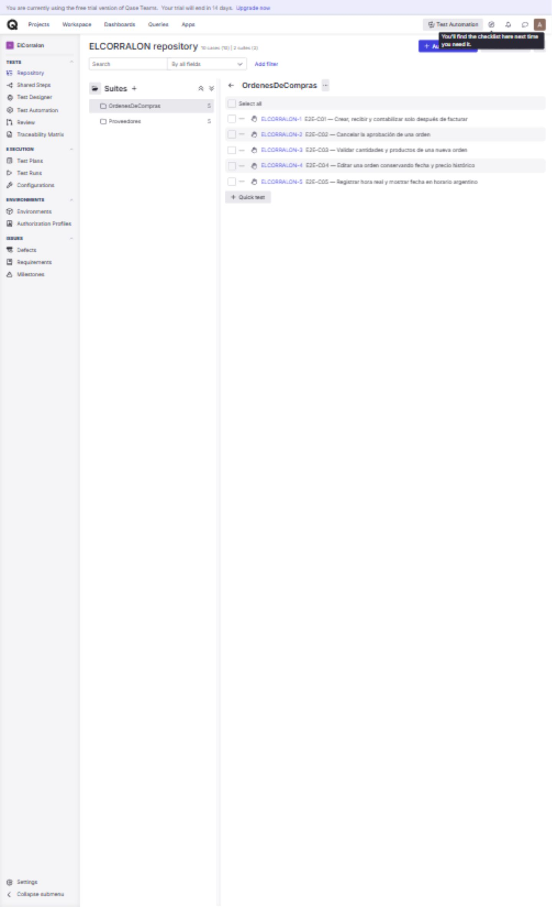
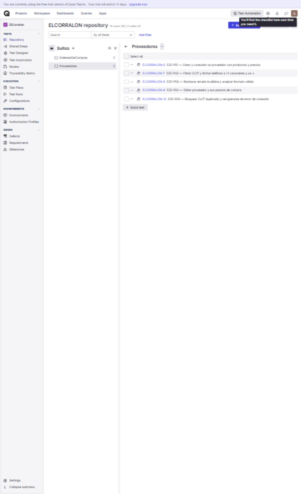

# Casos cargados en Qase

Proyecto: https://app.qase.io/project/ELCORRALON

Se completaron los diez registros vacíos existentes, conservando sus IDs y sus
dos suites. Cada caso tiene título, descripción, precondiciones, pasos, datos y
resultados esperados por paso. Son pruebas manuales pendientes de ejecución;
su carga no acredita resultados Passed ni integración real.

| ID Qase | Caso | Suite |
| --- | --- | --- |
| ELCORRALON-1 | E2E-C01 Crear, recibir y contabilizar solo después de facturar | OrdenesDeCompras |
| ELCORRALON-2 | E2E-C02 Cancelar la aprobación | OrdenesDeCompras |
| ELCORRALON-3 | E2E-C03 Validar cantidades y productos | OrdenesDeCompras |
| ELCORRALON-4 | E2E-C04 Editar conservando fecha y precio histórico | OrdenesDeCompras |
| ELCORRALON-5 | E2E-C05 Hora real y formato argentino | OrdenesDeCompras |
| ELCORRALON-6 | E2E-P01 Crear y consultar proveedor | Proveedores |
| ELCORRALON-7 | E2E-P02 CUIT y teléfono: filtros, 14 caracteres y un + | Proveedores |
| ELCORRALON-8 | E2E-P03 Validación de email | Proveedores |
| ELCORRALON-9 | E2E-P04 Editar proveedor y precios | Proveedores |
| ELCORRALON-10 | E2E-P05 CUIT duplicado y recuperación de conexión | Proveedores |

El caso E2E-P02 del diseño original se desglosó en filtros de CUIT/teléfono y
validación de email (E2E-P03). Los casos adicionales amplían el diseño manual con
validaciones, edición y regresiones cubiertas también por pruebas locales.

Evidencia de carga (no de ejecución):

Pendiente: crear Test Run, registrar versión del frontend y ambiente, ejecutar
contra la API desplegada con datos de prueba y guardar resultados reales y
capturas. No se crearon órdenes, proveedores ni facturas durante la carga en Qase.
